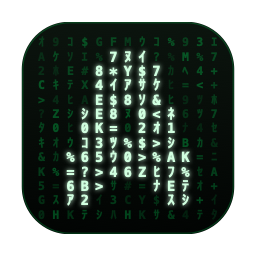

# Ametrix

<p align="center">
  
</p>

A native macOS Matrix-style digital rain screen saver and live wallpaper.

Ametrix installs as a real macOS `.saver` bundle and includes a live desktop
wallpaper. The renderer is native AppKit/CoreText code: no terminal emulator,
PTY, shell animation process, or external Matrix-rain dependency is required.

macOS still handles the actual authentication layer: password, Touch ID, Apple
Watch unlock, and screen-saver password policy.

## Features

- Native macOS screen saver bundle
- `Control-Command-Z` lock shortcut to override the macOS native version
- Optional live wallpaper mode
- Multi-display support
- Configurable color presets, density, speed, trails, font, and glyph palette
- No network access or telemetry

## Requirements

- macOS 13 or newer
- Xcode and `xcodegen` (`brew install xcodegen`) when building from source

## Quick Start

### Option 1
Download `Ametrix.dmg` from the latest GitHub release, open it, and drag
`Ametrix.app` into Applications.

### Option 2
Clone this repository and build the Universal 2 app from source:

```bash
scripts/rebuild-dev
```

This creates `dist/Ametrix.app`. Launch it directly:

```bash
open dist/Ametrix.app
```

The onboarding guide installs the screen saver and opens the relevant System
Settings page. After setup, use the menu bar icon to control the wallpaper, open
preferences, or quit Ametrix.

## Configuration

Edit the canonical TOML config:

```bash
~/Library/Application Support/Ametrix/config.toml
```

Example:

```toml
frameRate = 60
preset = "classic"
density = 1.0

fontName = "Menlo"
fontSize = 16

# Explicit colors override preset colors.
# backgroundColor = "#000000"
# headColor = "#d9ffd9"
# tailColor = "#00ff41"

minimumTailAlpha = 0.08
characters = "0123456789ABCDEFGHIJKLMNOPQRSTUVWXYZabcdefghijklmnopqrstuvwxyzアイウエオカキクケコサシスセソタチツテトナニヌネノハヒフヘホマミムメモヤユヨラリルレロワヲン@#$%&*+-=<>"

[speed]
min = 18
max = 38

[trail]
min = 14
max = 48
rowMultiplier = 0.75
```

Supported fields:

| Field | Purpose |
|---|---|
| `frameRate` | Animation frame rate, 15-120 |
| `preset` | Color preset: `classic`, `amber`, `cyan`, `white`, `violet` |
| `density` | Rain-column density, 0.2-3.0 |
| `fontName` / `fontSize` | Glyph font |
| `backgroundColor` | Hex background color |
| `headColor` | Hex rain-head color |
| `tailColor` | Hex trail color |
| `minimumTailAlpha` | Faintest tail opacity |
| `speed.min` / `speed.max` | Falling speed range |
| `trail.min` / `trail.max` | Trail length range |
| `trail.rowMultiplier` | Trail cap relative to screen rows |
| `characters` | Glyph palette |

Preset colors are applied first. Explicit color fields override preset colors.

`~/.config/ametrix/config.toml` is still read as a fallback for older installs. The older `config.json` format is only used when no TOML config exists.

## Screen Saver Container

Modern macOS runs `.saver` bundles inside:

```bash
~/Library/Containers/com.apple.ScreenSaver.Engine.legacyScreenSaver/Data
```

That container has its own home directory, so a screen saver process cannot
reliably read the normal user config path. Ametrix syncs the canonical TOML
config into the container before starting the screen saver.

## Development

Both the host app and the screen saver bundle are built from a single
`project.yml` (generated into `ametrix.xcodeproj` by `xcodegen`). The
screen saver target explicitly lists the shared source files it needs from
`Sources/ametrix/`, so renaming or deleting one of them breaks the build
instead of silently producing a stale bundle.

Two scripts cover everything:

```text
scripts/
  rebuild-dev     Local ad-hoc Debug build, staged to dist/, launched
  release.sh      Signed + notarized Universal 2 DMG into dist/
  branding/       Reproducible app icon renderer
  entitlements.plist   Empty entitlements applied to both bundles
```

Local dev loop (Debug, ad-hoc, fast iteration):

```bash
scripts/rebuild-dev                # Debug
scripts/rebuild-dev Release        # Release if you want a non-debug run
```

Release build (signs, notarizes, staples; ~minutes for the Apple queue):

```bash
scripts/release.sh
# -> dist/Ametrix-<version>-universal.dmg
```

Notarization uses the notarytool profile `notary` (override with
`AMETRIX_NOTARY_PROFILE`) in the signing keychain
`~/.keys/signing.keychain-db`, created by
`~/Projects/dotfiles/keys/signing-keychain.sh`.

For a signed-only local DMG without notarization:

```bash
AMETRIX_SKIP_NOTARIZE=1 scripts/release.sh
# -> dist/Ametrix-<version>-preview.dmg (ad-hoc, not for distribution)
```

## Architecture

```text
Sources/ametrix/main.swift
  App lifecycle, menu bar controller, wallpaper, and screen saver launch

Sources/ametrix/AmetrixConfiguration.swift
  TOML/JSON config loading, presets, screen saver container paths

Sources/ametrix/MatrixRainView.swift
  Native CoreText renderer

Sources/AmetrixScreenSaver/AmetrixScreenSaverView.swift
  ScreenSaverView wrapper around MatrixRainView
```

## Privacy

Ametrix does not collect telemetry, call network services, or shell out to
third-party animation tools. It reads local configuration files and installs its
bundled screen saver during onboarding.

## License

MIT. See [LICENSE](LICENSE).
